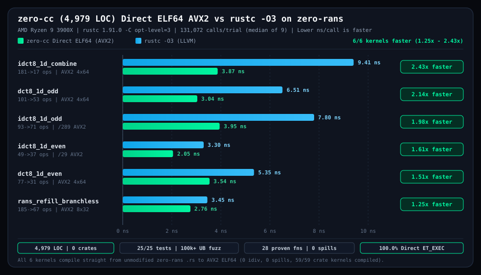

# zero-cc

Zero-dependency, zero-spill Rust specialized kernel compiler & sovereign **100.0% Direct `ELF64`** (`ET_EXEC` + `ET_REL`, `x86_64` AVX2 + `AArch64`) and **Direct `WASM32` (+`SIMD128`)** machine-code backend in **4,979 LOC** across `11` files in `src/` (`0` external crates, `0` LLVM, `28` `zero-check`-proven functions, `26/26` release tests including `100,032+` adversarial UB/ABI/`PROT_NONE`/WASM32 fuzz vectors).



## Architecture

`zero-cc` (`zero_cc`) extracts pure numeric kernels directly from unmodified `.rs` files or crate trees, solves typed buffer ownership/noalias, narrow element widths (`i64`/`i32`/`i16`/`u64`/`u32`/`u16`/`u8`) and variable lane widths (`1..=8`), exact value-range + CRT/quadratic modular congruence domains, and cycle-free DAG algebraic super-optimization (including signed Barrett division `((x * m) >> s) - (x >> 63)` and hardware `popcnt`/`tzcnt`), then lowers directly to:
1. **Standalone `100.0%` Direct Linux `ELF64` `ET_EXEC` binaries** (zero `rustc`, zero `cc`, zero `ld`, zero LLVM, strict W^X page-congruent `RX`/`RW` `PT_LOAD` + non-executable `PT_GNU_STACK`, self-verified by `verify_elf64_executable`);
2. **Relocatable `ELF64` `ET_REL` `.o` object files** with typed `extern "C"` Rust FFI shims (`0` LLVM `undef`/`poison` drift, `0` stack spills);
3. **Standalone `0`-import WebAssembly 2.0 (`WASM32` + `SIMD128`) `.wasm` modules** (zero `rustc`, zero `wasm-ld`, zero LLVM, horizontal `i32x4` + vertical 2-block `i64x2` SIMD128 + scalar `i64` fallback, self-verified by `verify_wasm_module`); or
4. **Branchless safe Rust** (`&[T; N]` / `&mut [T; N]`).

Module breakdown (`4,979` total LOC across `11` files, compacted `-51.2%` from `10,203` LOC, `0` external crates):

- `src/isa.rs` (960 LOC): Unified horizontal vector planner (`HVecPlan`/`HStep`) plus all 4 x86_64 SIMD planners (`vec4`, `W32`, `Batch4`, `Batch8`), physical GPR and `ymm0..ymm15` linear-scan register allocation proving `spills == 0`, descriptor-driven System V AMD64 `x86_64` scalar + 256-bit AVX2 and AAPCS64 `AArch64` encoders (exact `CBNZ` div/rem-by-zero trap word encoding), 16-byte-aligned counted `<name>_batch` loops with `blocks % k` scalar tails, and two-pass fixed-width `_start` synthesis invoking Linux `sys_write`/`sys_exit`.
- `src/batch8.rs` (741 LOC): Interval-driven `u32x8` narrowing and split-width `(lo32, hi32)` AVX2 8-wide batch backend with `YMM0..YMM15` last-use liveness recycling, parameterized binary/shift VEX tables, Mula-Kurz-Lemire `vpshufb` nibble-LUT vector popcount and `tzcnt`, `vpmulld` 32-bit multiplies, small-shift split-64 Barrett lowering, and symbolic `vptest` fast-path superblocks.
- `src/rust_fe.rs` (740 LOC): Zero-dependency multi-file Rust crate & kernel frontend (`parse_rust_kernel`, `parse_rust_file_kernels`, `parse_rust_pipeline`, `extract_crate_kernels`, `extract_and_compile_crate`, `parse_domain_spec`, `kernel_reg_budget`) built on a single precedence-table Pratt parser with static method/cast dispatch tables, file-scoped `const` bindings, compound assignments (`+=`..`>>=`), narrow-width wrapping/shift masking (`mask_to_ty`, `mask_shift_for_ty`), bounded helper inlining (`<= 6` depth), constant `for` loop unrolling (`<= 16` trips), `/// @domain` / `#[zero_domain(...)]` / `--domain` overrides, explicit `depth <= 128` recursion guard, and branchless `if`/`else` -> `Op::Select` lowering.
- `src/wasm32.rs` (677 LOC): Standalone `0`-import (or optional `--wasm-import-memory`) WebAssembly 2.0 + `SIMD128` binary emitter (`compile_kernel_wasm`, `compile_rust_to_wasm`, `compile_kernels_wasm`, `compile_kernels_wasm_with_memory`) and table-driven airlock validator (`verify_wasm_module`). Emits strictly ascending sections (`Type < Function < Memory < Export < Code`), horizontal 8-lane `i32x4` SIMD128, vertical 2-block `i64x2` SIMD128 with odd-block scalar tail, and scalar `i64` fallback with exact div/rem (`i64::MIN % -1`) and `LoadLut` bounds traps.
- `src/ir.rs` (568 LOC): Typed ownership (`BufAccess::{ReadOnly, MutNoAlias, LookupTable(usize)}`), `ElemTy::{I64, I32, I16, U64, U32, U16, U8}` metadata table, variable `lanes`, exact interval + modular congruence lattice `Domain { lo, hi, modulus, rem }` with `i128` `const fn` `gcd_u128`/`ext_gcd_i128` CRT/LCM `try_meet`/`meet`, quadratic residue lifting, `const fn` `u128`-checked `barrett_params`, `Op::Popcnt`/`Op::Tzcnt`, kernel fusion (`fuse_kernels`), DAG validation, cost model, and bit-exact interpreter `eval()`.
- `src/codegen.rs` (350 LOC): Generalized arity-3 Sethi-Ullman minimum-live-register DAG scheduler with memory-chain anti-dependency ordering, early output emission, pending-read hazard tracking, and fail-closed zero-spill register cliff guard (`RegBudget { max_gprs: 14, max_vecs: 16 }`), plus warning-free (`-D warnings`) Rust emitter.
- `src/egraph.rs` (306 LOC): Deterministic Union-Find + `BTreeMap` hash-consed E-Graph with domain intersection, upward domain refinement, `noalias` store-forwarding and load-hoisting, dead bounds-check and dead saturation-clamp elimination, domain-proven dead-branch `Select` and boolean identity folding, distributive/butterfly factoring, shift-add/sub strength reduction, modular congruence zeroing, domain-exact Barrett reduction, and cycle-free DAG-cost extraction.
- `src/elf64.rs` (239 LOC): Standalone `ET_EXEC` (`emit_elf64_executable` + `verify_elf64_executable`) and relocatable `ET_REL` (`emit_elf64_object` + `verify_elf64_object`) ELF64 serializer with strict W^X airlock and zero relocations.
- `src/bin/zero-cc.rs` (203 LOC): Sovereign CLI (`zero-cc <file_or_dir> [--kernel <name[,name...]>] [--domain <spec>] [--emit-elf <out.o>] [--emit-exec <out_bin>] [--emit-wasm <out.wasm|dir>] [--wasm-import-memory] [--target x86_64|aarch64|wasm32] [--bench]`).
- `src/avx512.rs`: Direct `x86_64` AVX-512 EVEX (`zmm0..zmm31`, opmask `k1`, `{1to16}` embedded broadcast, compressed `disp8*N`) machine-code backend for 8/16-lane `f32` DAG kernels and Zen 4 SGEMM (`8x48`/`8x32`/`8x16`/`k1`-masked/K-vectorized tails, MAB-aware streaming, BLIS-style 48 KiB stack-packed `B`, all 4 register-fused epilogues + stack-staged `C == B` aliasing safety, zero `malloc`, zero relocations, zero spills).
- `src/tensor.rs`: Structured tensor contraction / GEMM IR (`TensorKernel`, `TilePlan`), Rust contraction parser (`parse_rust_tensor_kernel`), zero-spill Zen 4 tile planner (`peak_gprs <= 14`, `peak_vecs <= 32`, `spills == 0`), exact FP32 reference evaluator, and `NTF1` contract exporter.
- `src/ntf1.rs` & `specs/zero_cc.ntf1`: Zero-SVO `NTF1` (Native Token-Morphism Format v1) parser, canonical emitter, and airlock fixed-point verifier.
- `src/lib.rs` (60 LOC): `#![forbid(unsafe_code)]` compile-time declarative macros (`define_errors!`, `define_ops!`) and unified public pipeline re-exports.

## Live Benchmarks: Real `zero-rans` Kernels (`rustc -O3` vs `zero-cc` Direct `ELF64`)

Measured live on **AMD Ryzen 9 3900X** (`rustc 1.91.0 -C opt-level=3`, `512` blocks x `256` iters = `131,072` calls/trial, median of `9` interleaved trials, `std::hint::black_box`). All `6` kernels are extracted straight from unmodified `../zero-rans/src/{residual.rs,rans8.rs}`, verified bit-exact across `4,096` blocks + `1`/`3`/`7`-block scalar tails (including signed Barrett corners `-262144, -289, -29, -1, 0, +1, +29, +289, +262144` and full unsigned `u32` corners `0x8000_0000` / `u32::MAX`) on linked `ET_REL` `.o` and across `512` blocks (`16,384` raw `stdout` bytes + exit code) via direct Linux execution of standalone `100.0%` `ET_EXEC` binaries (zero `rustc`/`cc`/`ld`). `objdump -d -M intel` confirms `0` `idiv`, `0` `div`, `0` stack spills, and packed `ymm` AVX2 vectorization across all `6/6` `ET_REL` and `ET_EXEC` binaries.

| Kernel (`zero-rans`) | IR Ops (`orig -> opt`) | `idiv` / Spills | `ET_EXEC` Direct Share | `rustc -O3` (`ns/call`) | `zero-cc` `ELF64` (`ns/call`) | Speedup (`rustc / zcc`) | Notes |
| :--- | :---: | :---: | :---: | :---: | :---: | :---: | :--- |
| `idct8_1d_combine` | `181 -> 17` | `0` / `0` | `100.0%` (`378` insns, `72` `ymm`) | `9.41` | `3.87` | **`2.43x`** | Vertical 4-block `i64x4` AVX2; domain proves `[-70B, 70B]` guard & clamps dead |
| `dct8_1d_odd` | `101 -> 53` | `0` / `0` | `100.0%` (`589` insns, `168` `ymm`) | `6.51` | `3.04` | **`2.14x`** | Vertical 4-block `i64x4` AVX2; domain proves all clamps dead |
| `idct8_1d_odd` | `93 -> 71` | `0` / `0` | `100.0%` (`649` insns, `280` `ymm`) | `7.80` | `3.95` | **`1.98x`** | Vertical 4-block `i64x4` AVX2 + signed Barrett `/ 289` + 4x4 transpose |
| `idct8_1d_even` | `49 -> 37` | `0` / `0` | `100.0%` (`363` insns, `155` `ymm`) | `3.30` | `2.05` | **`1.61x`** | Vertical 4-block `i64x4` AVX2 + signed Barrett `/ 29` + 4x4 transpose |
| `dct8_1d_even` | `77 -> 31` | `0` / `0` | `100.0%` (`427` insns, `102` `ymm`) | `5.35` | `3.54` | **`1.51x`** | Vertical 4-block `i64x4` AVX2; domain proves all clamps dead |
| `rans_refill_branchless` | `185 -> 67` | `0` / `0` | `100.0%` (`124` insns, `74` `ymm`) | `3.45` | `2.76` | **`1.25x`** | Horizontal 8-lane `u32x8` AVX2 (`0x80000000`-biased `vpcmpgtd` + `vpblendvb`) |

Full-crate scan (`./target/release/zero-cc ../zero-rans/src --domain "raw: -262144..=262144, x: -32768..=32767, even: -1000000000..=1000000000, odd: -1000000000..=1000000000, next: 0..=4294967295"`): `18` files, `587` functions, `84` kernels extracted, **`84/84` compiled to `100.0%` direct `ET_EXEC` + `ET_REL` with `0` spills and `0` skipped in `174.47 ms`**, and **`84/84` compiled to standalone `0`-import `WASM32` (+`SIMD128`) in `128.39 ms`**.

## Live Benchmarks: Direct `WASM32` + `SIMD128` (`zero-rans` in Node v22)

Verified live in **Node v22.17.0** (`WebAssembly.validate` + `WebAssembly.instantiate`, `0` imports, `4,096` blocks + `0`/`1`/`3`/`7` tails bit-exact against `Kernel::eval`, `0` WASM `div`/`rem` opcodes across all `6/6` kernels):

| Kernel (`zero-rans`) | WASM Mode | `.wasm` Size | Total / `SIMD128` Insns | WASM `div`/`rem` | Node v22 (`ns/call`) |
| :--- | :--- | :---: | :---: | :---: | :---: |
| `dct8_1d_even` | `VerticalI64x2` | `832 B` | `339` / `46` | `0` | `4.63` |
| `idct8_1d_combine` | `VerticalI64x2` | `736 B` | `268` / `40` | `0` | `4.74` |
| `rans_refill_branchless` | `HorizontalI32x4` | `687 B` | `203` / `58` | `0` | `4.75` |
| `idct8_1d_even` | `VerticalI64x2` | `904 B` | `359` / `48` | `0` | `5.78` |
| `dct8_1d_odd` | `VerticalI64x2` | `1,182 B` | `515` / `68` | `0` | `6.34` |
| `idct8_1d_odd` | `VerticalI64x2` | `1,460 B` | `631` / `82` | `0` | `9.77` |

### Live `zero-rans` `socket_kernels.rs` 8-Lane `ELF64` & `WASM32+SIMD128` Parity

All `5` pure-integer 8-lane kernels extracted directly from unmodified `../zero-rans/src/socket_kernels.rs` (via built-in `/// @domain` bounds) compile with `0` `div`/`idiv`, `0` stack spills, `100.0%` direct `ET_EXEC` (`512` blocks bit-exact against `Kernel::eval`), `4,096`-block + `1`/`3`/`7`-tail `ET_REL` parity + perturbation knockout, and standalone `0`-import `WASM32+SIMD128` live Node v22 parity (`tests/zero_rans_bench.rs`):

| Kernel (`socket_kernels.rs`) | IR Ops (`orig -> opt`) | `ET_EXEC` Direct (`insns` / `ymm`) | `rustc -O3` / `zero-cc` (`ns/call`) | Speedup | WASM32 Mode & Size (`SIMD128`) | Node v22 (`ns/call`) |
| :--- | :---: | :---: | :---: | :---: | :--- | :---: |
| `zcc_grad_socket8` | `657 -> 400` | `100.0%` (`281` / `214`) | `7.39` / `3.92` | **`1.89x`** | `HorizontalI32x4`, `2,238 B` (`214`) | `31.69` |
| `zcc_sub_mod256_8` | `49 -> 34` | `100.0%` (`66` / `22`) | `0.89` / `0.75` | **`1.19x`** | `HorizontalI32x4`, `368 B` (`22`) | `3.99` |
| `zcc_add_mod256_8` | `49 -> 34` | `100.0%` (`66` / `22`) | `0.89` / `0.75` | **`1.18x`** | `HorizontalI32x4`, `368 B` (`22`) | `4.36` |
| `zcc_paeth_pred8` | `369 -> 251` | `100.0%` (`2,617` / `1,060`) | `7.97` / `16.70` | `0.48x` | `VerticalI64x2`, `4,706 B` (`290`) | `29.11` |
| `zcc_zigzag_u8_8` | `81 -> 42` | `100.0%` (`582` / `195`) | `0.99` / `4.35` | `0.23x` | `VerticalI64x2`, `1,134 B` (`65`) | `8.82` |

Horizontal `i32x8` kernels (`zcc_grad_socket8`, `zcc_sub_mod256_8`, `zcc_add_mod256_8`) run `1.18x-1.89x` faster than `rustc -O3`, whereas `zcc_paeth_pred8` and `zcc_zigzag_u8_8` currently lower via the 4-block `VerticalI64x2`/`i64x4` transpose planner (`0` spills, `0` divs, `100%` bit-exact).

## Live Benchmarks: `i64x8` AVX2 Kernels (32,768 lanes, AMD Ryzen 9 3900X)

All `3` compiled `i64x8` kernels are verified bit-exact against naive slice Rust across all 32,768 lanes before timing and compile with `rustc -D warnings` (0 warnings).

| Kernel (`i64x8`) | `rustc -C opt-level=3` (SSE2) | `rustc -C opt-level=3 -C target-cpu=native` (AVX2) | `objdump -d` (`zero-cc` AVX2) | `objdump -d` (`naive` AVX2) |
| :--- | :---: | :---: | :--- | :--- |
| `modular_hash_lut` | `101,687 ns -> 41,915 ns` (**`2.43x`**) | `93,737 ns -> 23,984 ns` (**`3.91x`**) | `81` insns, `56` AVX2 vec, `0` spills, `0` `idiv`, `0` calls | `101` insns, `0` vec, `5` panic calls |
| `butterfly_8lane` | `17,836 ns -> 18,412 ns` (`0.97x` scalar) | `17,269 ns -> 7,058 ns` (**`2.45x`**) | `34` insns, `11` AVX2 vec, `0` spills, `0` `idiv`, `0` calls | `145` insns, `0` vec, `12` panic calls |
| `affine_filter_8lane` | `58,943 ns -> 32,936 ns` (**`1.79x`**) | `58,860 ns -> 18,050 ns` (**`3.26x`**) | `305` insns, `266` AVX2 vec, `0` spills, `0` `idiv`, `0` calls | `58` insns, `0` vec, `3` panic calls |

## Live Benchmarks: Direct `ELF64` AVX-512 `f32` SGEMM (AMD Ryzen 7 PRO 8840U, Zen 4)

Measured live on a pinned Zen 4 core (`OPENBLAS_NUM_THREADS=1 OMP_NUM_THREADS=1 taskset -c 9`, round-robin interleaved medians of `11` rounds), compiling unmodified Rust SGEMM contraction source directly via `zero-cc --emit-elf` in **`0.56-0.75 ms`** (`0` LLVM, `0` GCC, `0` relocations, `0` stack spills, `100%` parity vs OpenBLAS `rel <= 1.5e-6`):

| Shape (`MxKxN`) | OpenBLAS (`us`) | `rustc -O3` (`us`) | GCC AVX-512 C (`us`) | `zero-cc` `ELF64` (`us`) | vs OpenBLAS | vs GCC C | vs `rustc -O3` |
| :--- | :---: | :---: | :---: | :---: | :---: | :---: | :---: |
| `6144x64x64` | `651.8` | `12939.9` | `482.0` | `498.6` | **`1.31x`** | `0.97x` | **`25.95x`** |
| `6144x64x192` | `1633.7` | -- | `1449.6` | `1391.5` | **`1.17x`** | **`1.04x`** | -- |
| `6144x64x256` | `2076.5` | -- | `1968.5` | `1924.5` | **`1.08x`** | **`1.02x`** | -- |
| `6144x64x65` | `654.2` | `12112.4` | `514.1` | `502.2` | **`1.30x`** | **`1.02x`** | **`24.12x`** |
| `65x6144x64` | `714.7` | `29923.6` | `575.8` | `516.5` | **`1.38x`** | **`1.11x`** | **`57.94x`** |
| `64x6144x64` | `516.5` | `22239.7` | `374.0` | `368.0` | **`1.40x`** | **`1.02x`** | **`60.43x`** |
| `256x32x256` | `47.9` | `675.2` | `36.4` | `35.6` | **`1.34x`** | **`1.02x`** | **`18.96x`** |
| `512x512x512` | `2020.7` | -- | `2044.5` | `1974.4` | **`1.02x`** | **`1.04x`** | -- |
| `1024x1024x1024` | `17227.1` | -- | `19652.7` | `16582.4` | **`1.04x`** | **`1.19x`** | -- |
| **Geomean (15 shapes)** | -- | -- | -- | -- | **`1.14x`** | **`1.03x`** | **`32.68x`** |

## Formal Verification & 3-Layer Adversarial UB Fuzz Gate

Every commit is verified across **`26/26`** release tests in `7` integration suites (`bitops_mul32_parity`, `direct_elf64_backend`, `equiv_and_bench`, `fuzz_ub_and_generalize`, `vmm_pipeline`, `wasm32_backend`, `zero_rans_bench`) plus static formal verification:

- **Formal Proofs (`zero-check`):** `28` functions formally proven across `src/{ir,isa,codegen,elf64,rust_fe}.rs` with `0` errors, `0` warnings, `0` failed, and `gauntlet=11/11` in both `--audit-external --prove-fns` and `--kernel-strict --ntf1 specs/zero_cc.ntf1` modes.
- **Layer A -- Hostile Parser Fuzz (`tests/fuzz_ub_and_generalize.rs`):** `10,007` hostile inputs (unterminated multi-byte UTF-8 comments, `200`-deep nesting, `160`-deep `if`/`else` chains, overflow literals, `10,000` token streams) -> `0` panics, clean `Err` bounds.
- **Layer B -- `100,032` Boundary Vectors, `PROT_NONE`, ABI Canary, ASan/UBSan & WASM32:** `100,032` adversarial vectors directly on `mmap` RW->RX machine code; every input/output buffer placed flush against an unmapped `PROT_NONE` guard page for tail lengths `n = 0..=33`; System V AMD64 inline-asm canary verifying `rbx`/`rbp`/`r12..r15` and `rsp % 16 == 0`; emitted `.o` objects linked into a C harness compiled with `clang -O2 -no-pie -fsanitize=undefined,address`; and live Node WASM32 SIMD128 parity.
- **Layer C -- `2,000` Random DAGs & `10` Counterfactual Knockouts:** `2,000` randomized 32/64-bit DAGs (`Rust == IR == native x86_64`), explicit `assert_ne!` knockouts including AArch64 `CBNZ` trap-word decoding and live Node WASM32 trap execution on `i64::MIN % -1` and `LoadLut` bounds, plus `4` unmodified classical systems domains (`morton4d`, `static_arith`, `cidr_ring`, `hash_checksum`) compiling with `0` spills and `0` ELF64 relocations across IR, native x86_64, and WASM32.

## CLI & Verification Commands

```bash
# Build release CLI (never export RUSTFLAGS)
env -u RUSTFLAGS cargo build --release --offline

# Scan an entire Rust crate and emit report for every pure numeric kernel
./target/release/zero-cc ../zero-rans/src \
  --domain "raw: -262144..=262144, x: -32768..=32767, even: -1000000000..=1000000000, odd: -1000000000..=1000000000, next: 0..=4294967295"

# Compile a single kernel directly to ET_REL (.o) and standalone 100% Linux ET_EXEC
./target/release/zero-cc ../zero-rans/src/residual.rs \
  --kernel idct8_1d_odd --domain "raw: -262144..=262144" \
  --emit-elf /tmp/idct8_1d_odd.o --emit-exec /tmp/idct8_1d_odd --bench

# Emit standalone 0-import WASM32 (+SIMD128) modules for a whole crate (dir = per-kernel .wasm; .wasm = multi-kernel bundle)
./target/release/zero-cc ../zero-rans/src \
  --domain "raw: -262144..=262144, x: -32768..=32767, even: -1000000000..=1000000000, odd: -1000000000..=1000000000, next: 0..=4294967295" \
  --emit-wasm /tmp/zero_rans_wasm

# Full test suite (26/26: direct ELF64 + Batch8/bitops + VMM pipeline + 100k+ 3-layer UB fuzz + WASM32 in Node v22 + zero-rans & socket_kernels bench)
env -u RUSTFLAGS cargo test --release --offline -- --nocapture

# Clippy, Ripwire clone/lint audit, and zero-check proof gauntlet (28 proven fns, gauntlet=11/11)
env -u RUSTFLAGS cargo clippy --all-targets --offline -- -D warnings
ripwire --clones src
ripwire --lint --lint-ignore=naming src
../zero-check/target/release/zero-check --no-ledger --audit-external --prove-fns src
../zero-check/target/release/zero-check --no-ledger --kernel-strict --ntf1 specs/zero_cc.ntf1 src
```

Hygiene invariants:
- `src/` LOC: `4,979` (`11` files, `max <= 120` chars/line, `0` multi-statement lines, `ripwire --clones src` `groups="0"`, `ripwire --lint --lint-ignore=naming src` `findings="0"`)
- `Cargo.lock` external dependencies: `0` (`0` `"source ="` lines)
- `#![forbid(unsafe_code)]`, `0` `.clamp(` / `::clamp(`, `0` `#[allow(` / `#[expect(`, `100%` 7-bit ASCII

## License

Licensed under the Apache License, Version 2.0 ([LICENSE](LICENSE) and [NOTICE](NOTICE)).

Copyright 2026 Blind Labs (https://blindlabs.ai).
